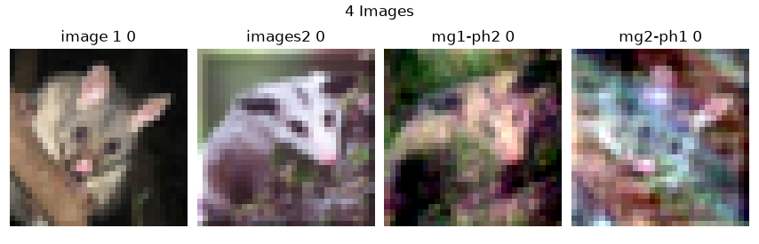

# fourier-phase-swapping
Data augmentation using Fourier Phase Swapping on CIFAR-100

## Example  : 

The following figure illustrates Fourier Phase Swapping, where the magnitude spectrum of one image is combined with the phase spectrum of another image.

